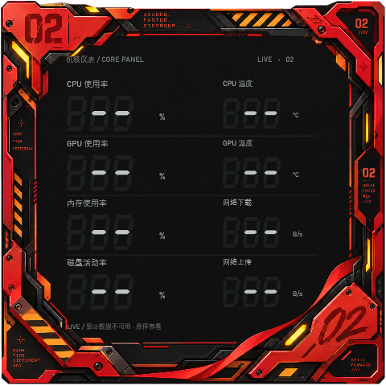
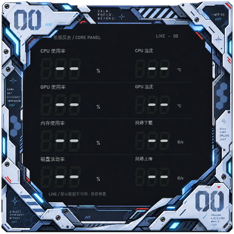
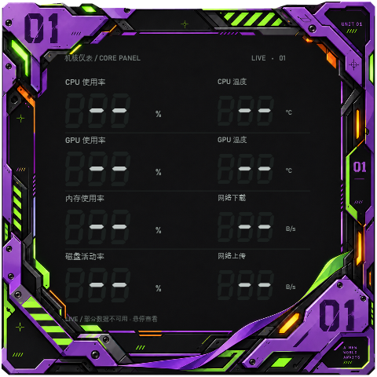

# 机核仪表

机核仪表是一个 Windows x64 桌面硬件监测小组件。八个显示位置可独立选择指标，默认显示 CPU、GPU、内存、磁盘活动率和网卡实时收发速率。

| 02 赤红 | 00 冰蓝 | 01 紫绿 | 08 樱粉 |
| --- | --- | --- | --- |
|  |  |  |  |

上图来自程序自检渲染，使用测试数据。

## 快速开始

1. 打开仓库的 **Releases**，下载 `LcdWidget-v1.6.0-win-x64.zip`，完整解压到准备长期使用的位置。
2. 打开解压得到的 `机核仪表` 文件夹，双击 `机核仪表.exe`。便携包已包含 .NET 桌面运行时。
3. 左键拖动仪表，右键可打开设置、切换皮肤、调整尺寸或隐藏至托盘。双击托盘图标可以恢复窗口。

现有用户可以退出旧版后运行新目录里的程序。配置存放于 `%LOCALAPPDATA%\LcdWidget\settings.json`。如果启用了开机自启动，移动程序前先关闭自启动，移动完成后从新位置启动并重新开启。

## 监测与权限

- 在 **设置 → 显示与外观** 选择指标，在 **网络** 选择自动网卡或指定接口。收发速率来自所选网卡，每秒采样，按 1024 换算 B/s、KB/s、MB/s 和 GB/s。磁盘活动率表示设备忙碌时间占比。
- `--` 表示暂无有效读数。悬停读数或打开 **传感器状态**，可查看数据来源、最近尝试时间和最后一次有效读数。
- 温度取决于硬件、驱动和访问权限。部分 CPU 温度需要单独安装 [PawnIO 官方驱动](https://github.com/namazso/PawnIO.Setup/releases/tag/2.2.0)，然后从右键菜单以管理员身份重启。其他指标可先在普通权限下查看。
- **导出诊断** 将报告保存到所选本地路径。公开反馈时请检查诊断内容，删除设备标识和其他个人信息。

## 从源码构建

在 Windows x64 上安装 [.NET 10 SDK](https://dotnet.microsoft.com/download/dotnet/10.0)，版本要求见 [global.json](global.json)。在仓库根目录使用 PowerShell。

```powershell
dotnet restore .\LcdWidget\LcdWidget.csproj -r win-x64 --locked-mode -p:SelfContained=true
dotnet build .\LcdWidget\LcdWidget.csproj -c Release -r win-x64 --self-contained true --no-restore
.\build.ps1
```

`build.ps1` 生成 `release/v1.6.0/` 下的便携 ZIP 和 SHA-256 文件。可用 `-OutputDirectory` 指定另一个输出目录。重新打包同一版本时请选择一个新输出目录。构建完成后可使用 `Get-FileHash -Algorithm SHA256` 核对 ZIP。

在本机桌面会话中运行自检。自检包括 Windows 图形设备和网络接口枚举，以及四款皮肤的实际渲染。

```powershell
$exe = Resolve-Path .\LcdWidget\bin\Release\net10.0-windows\win-x64\LcdWidget.exe
$report = Join-Path $PWD 'artifacts\verify'
$test = Start-Process -FilePath $exe.Path -ArgumentList @('--verify', ('"' + $report + '"')) -Wait -PassThru
$test.ExitCode
```

退出码为 `0` 时可查看 `artifacts/verify/checks.json`。GitHub Actions 验证锁定还原与 Release 编译，硬件和渲染检查在 Windows 桌面运行。

## 反馈与许可

请在仓库的 **Issues** 页面提供应用版本、Windows 版本、复现步骤和所需权限。

项目自有代码、文字文档和图标采用 [MIT 许可](LICENSE)。皮肤和演示图的使用范围见 [皮肤素材说明](docs/SKIN-ASSETS.md)。依赖版本、许可与源码链接见 [第三方声明](THIRD-PARTY-NOTICES.md)。
